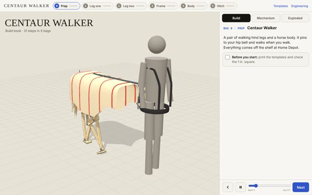

# Centaur Walker



Horse hindquarters on two Jansen-linkage legs that pin to your hip belt or your bike's seatpost. As you walk or ride, the ground turns the legs, so one hoof is always on the floor. Every part comes off the shelf at Home Depot: pine 1×2, 1/2 in. plywood, 3/8 in. bolts, a 3 in. PVC ring, 1/2 in. EMT, PEX, and a drop cloth.

**Live site:** https://hartswf0.github.io/centaur-walker/ (after GitHub Pages is turned on, see below)

## Current pages

| Page | What it is |
|---|---|
| [build-book.html](build-book.html) | LEGO-style build book. **Build**: 5 bags, 31 steps, exploded 3D steps with real dimensions, a parts box per step, sub-builds, and a check on every step. **Mechanism**: the whole machine on your bike or on you, skin off, with the power path drawn on it. **Exploded**: every piece apart with its size, plus the full cut list. |
| [walker.html](walker.html) | Engineering instrument: statics, pivot friction, leg inertia, hoof grip and skid speed, roll, side play, buckling, cost, shop list with Home Depot items, and tests that are all computed. |
| [powertrain.html](powertrain.html) | The physical velocipede drive as built: rear tyre → red scooter wheels → paint-roller cage → top axle. Enter measured diameters and axle positions; it gives road per crank turn against the legs' target, crank rpm, rotation direction, belt cut lengths, and how to build the threaded top axle so it stops unscrewing. |
| [templates.html](templates.html) | 13 full-size letter sheets (print at 100%): every bar with its hole crosses, the plate corners, the hub ring wrap, the hoof pad. Also as [templates.pdf](templates.pdf). |

## Key numbers (current design)

- Rear weight about 6.5 kg. Load on you averages near zero and swings about −1.4 to +1.6 kg each stride.
- Parts about $325 from Home Depot, about $218 with salvage.
- One crank turn per 872 mm travelled: one turn per stride walking, 2.51 crank turns per turn of a 700c rear wheel.
- The ground drives the legs, so hooves stay planted up to about 3.3 km/h on asphalt and 2.4 km/h on grass. There is no chain or belt from the bike wheel to the legs.
- Every hole spacing is a whole number of 3/4 in., so a tape measure marks every bar.

## Earlier versions

Every version made along the way is kept in [`versions/`](versions/), in order:

| Version | Notes |
|---|---|
| [Leg Rig v1](versions/01-leg-rig-v1.html) | 2D study of the horse hind leg. One phase value drives the gait; the Muybridge 1878 plate, a Jansen linkage, and a cut template that scales from card and brads to foam. |
| [Leg Rig v3](versions/02-leg-rig-v3.html) | Horse, walk and bike modes, an evolve view, and gait, layer and build panels. |
| [Workshop v1](versions/03-workshop-v1.html) | First 3D bench for the leg: explode, section, parts and cut views. |
| [Studio prompt ](versions/04-studio-prompt.html) | The run prompt for this project, modeled on SCION, to paste into a new session with the current files. |
| [Leg Rig v4](versions/05-leg-rig-v4.html) | Adds a 2D view beside the horse, walk, bike and evolve modes. |
| [Leg Rig final](versions/06-leg-rig-final.html) | Last version of the 2D rig. |
| [Workshop final](versions/07-workshop-final.html) | 3D bench in millimetres: 3D, side, section, linkage, cut, build, joint, source, finish and test views. |
| [Studio ](versions/08-studio.html) | The rig and the workshop combined in one page, with build, horse, walk, bike and evolve modes. |
| [Velocipede v1](versions/09-velocipede-v1.html) | Legs driven from the bike: a roller on the rear tyre, gears and a chain to the leg crank. 3D, elevation, plate and leg views. |
| [Velocipede v2](versions/10-velocipede-v2.html) | Second pass at the bike drive: build, parts, drive and joint panels. |
| [Velocipede v3](versions/11-velocipede-v3.html) | Adds the backpack version alongside the bicycle version. |
| [Velocipede v5](versions/12-velocipede-v5.html) | Adds an evolve view and centaur and Trojan horse bodies. |
| [Velocipede v6](versions/13-velocipede-v6.html) | Smaller, lighter backpack and body. |
| [Velocipede final](versions/14-velocipede-final.html) | Adds the test bench: engineering, price, strength and looks scored side by side. |
| [Walker v1](versions/15-walker-v1.html) | New design from scratch: hindquarters on two ground-driven Jansen legs, pinned to your hip belt or seatpost. Manual, 3D, side, plate and leg views; steps, shop, tests and record. |
| [Walker v1b](versions/16-walker-v1b.html) | Revision of v1 before the full rewrite. |
| [Walker v2a](versions/17-walker-v2a.html) | Rewrite: pine legs on a centre plate and a drive view with torque, grip, weight on you and roll. |
| [Walker v2b](versions/18-walker-v2b.html) | Phone layout: step text and callouts kept off the model. |
| [Walker v3](versions/19-walker-v3.html) | 1×4 hoof pad flush with the inner bar face; 15-1/4 × 13 in. plate. |
| [Build book v1](versions/20-build-book-v1.html) | First LEGO-style build book: 5 bags, exploded steps, parts box, a check on every step. |
| [Stride Plate](versions/21-stride-plate.html) | Rig line: redesign of the GeoGebra Jansen horse around six principles. |
| [Centaur Rig v1](versions/22-centaur-rig-v1.html) | Rig line: every joint followed through time; joints as holes in flat plates. |
| [Centaur Rig v2](versions/23-centaur-rig-v2.html) | Rig line: one pair of legs on a backpack or the bike rack, friction roller on the tyre. |
| [Centaur Rig v3](versions/24-centaur-rig-v3.html) | Rig line: one-screen physics bench, feet in your foot plane, breakage and slop. |
| [Centaur Rig v4](versions/25-centaur-rig-v4.html) | Rig line: layer stacks, friction, sound, variants A–D, tolerances. |
| [Centaur Rig v5](versions/26-centaur-rig-v5.html) | Rig line: phone-first joint lab, nine joint types at every pin. |
| [Build-shop prompt](versions/27-build-shop-prompt.html) | Rig line: the SCION prompt rewritten for this rig. |

## Centaur Rig line

A second line of the work: Jansen legs cut from 1 in EPS foam or 1/4 in plywood on the original Jansen lengths, in two builds. **Backpack**: legs hang from your hip belt and a ground wheel drives them. **Bike**: legs hang from the rear rack and a roller on the rear tyre drives them. Full history in [rig/LINEAGE.md](rig/LINEAGE.md).

| Page | What it is |
|---|---|
| [rig/design-set.html](rig/design-set.html) | Build drawings for both builds: 16 exposures, Z map, drive, pin stacks, every part with dimensions, mounts, cut list, buy list, steps, checks. |
| [rig/centaur-rig.html](rig/centaur-rig.html) | The leg engine: walk and bike modes, Muybridge plate, joints under load, real stock and joints, part drawings and stacks. |
| [rig/centaur-rig-design-files.zip](rig/centaur-rig-design-files.zip) | Every part as 1:1 SVG and DXF, tiled Letter PDFs, and design-data.json. Also unpacked in [rig/files/](rig/files/). |
| [rig/source/](rig/source/) | The scripts that rebuild the files from the engine. |

Versions 21–27 in `versions/` are this line: Stride Plate, Centaur Rig v1–v5, and the build-shop prompt.

Backpack: crank axle 899 mm, 1296 mm of ground per crank turn, 3.9 kg, about $234. Bike: crank axle 700 mm, 60 rpm at 16 km/h, 3.2 kg, about $190. Computed and checked by independent reviewers; not yet built.

## Files

```
index.html        gallery of every page
build-book.html   current build book
walker.html       current engineering page
templates.html    current templates (and templates.pdf)
versions/         every earlier version, numbered in order
rig/              Centaur Rig line: engine, design set, files, source, LINEAGE.md
thumbs/           screenshots used by the index
favicon.svg
```

Each page is a single self-contained HTML file. The 3D pages load three.js r128 from cdnjs and fonts from Google Fonts; nothing else is fetched.

## Run locally

Open `index.html` in a browser, or serve the folder:

```
python3 -m http.server 8000
```

## Publish with GitHub Pages

Settings → Pages → Build and deployment → Source: *Deploy from a branch*, Branch: `main`, folder `/ (root)`. The site appears at `https://hartswf0.github.io/centaur-walker/`.

---

Watson Hartsoe · CONSEQUENCE WORKS / FANTROL · October 2026
